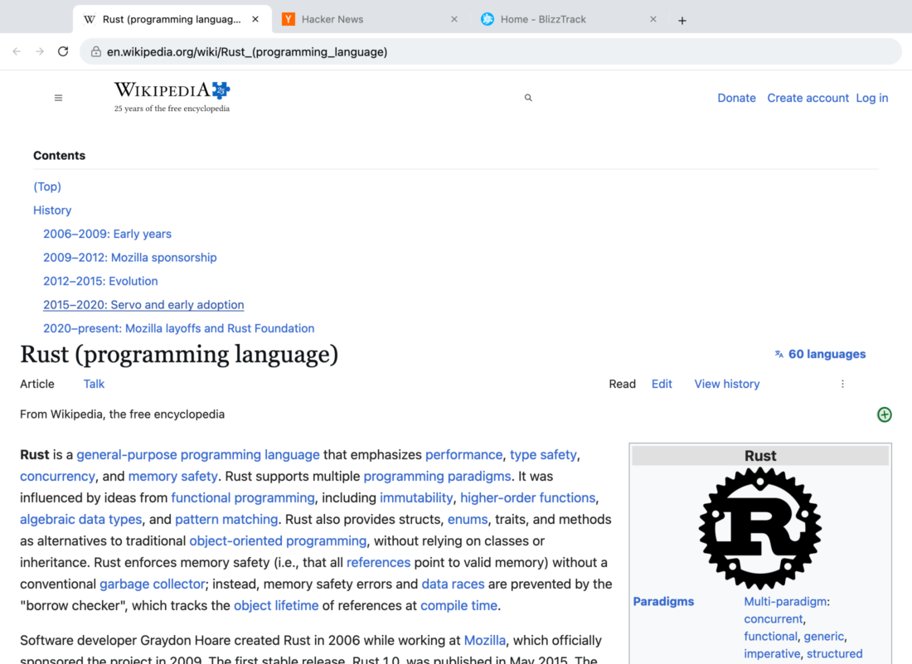
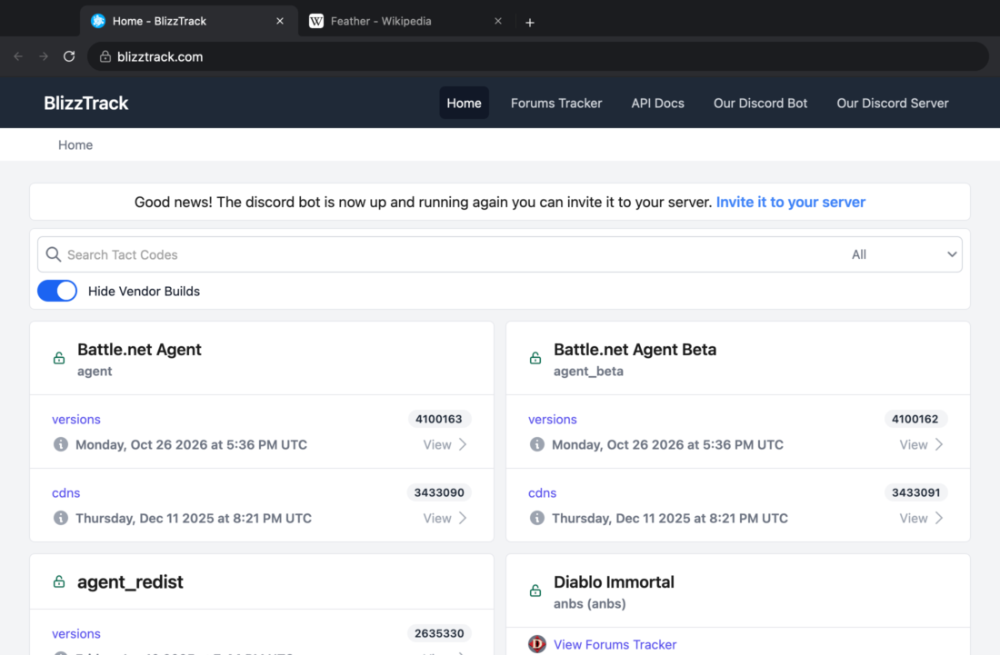
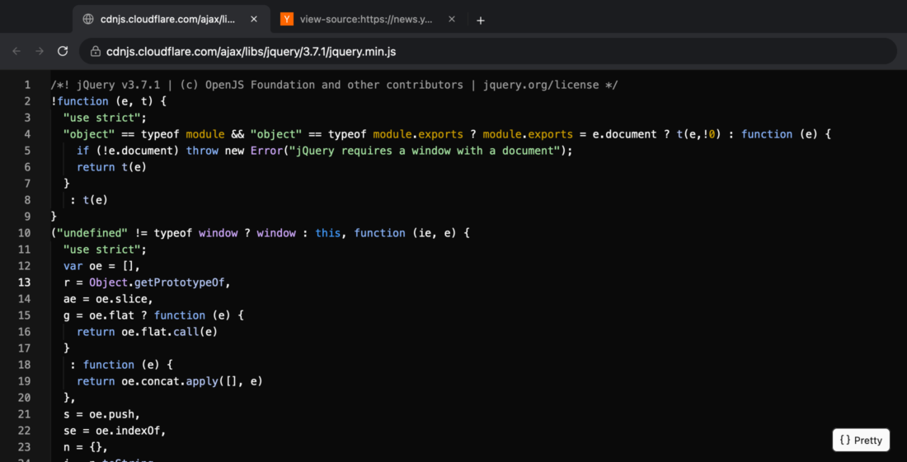
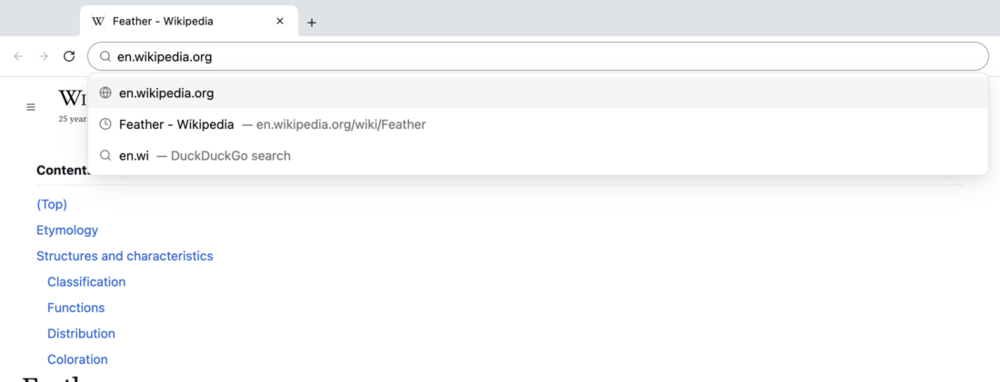
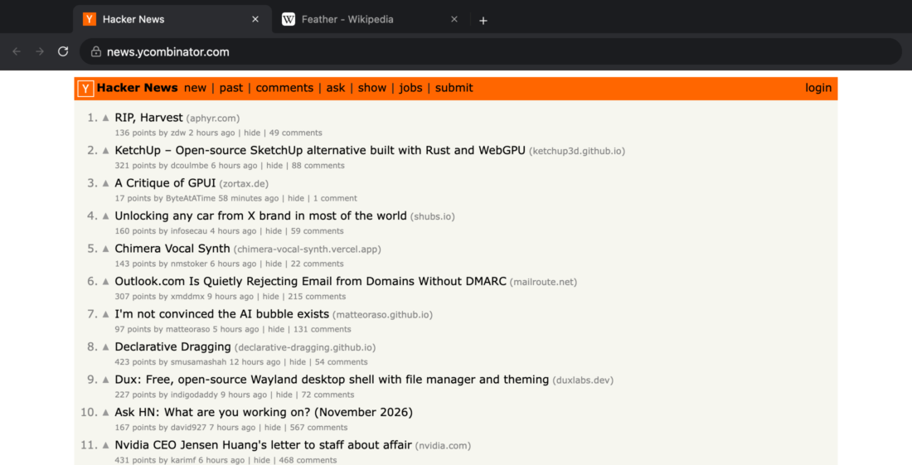

# Feather 🪶

**A web browser with no web engine.** It's called Feather because it's so light. It runs JavaScript anyway, in a JavaScript engine written in Rust.

Feather parses HTML, runs the CSS through a cascade it wrote itself, and turns the page into **native [GPUI](https://www.gpui.rs) elements**, the same UI framework the Zed editor is built with. There's no WebView, no Blink, no WebKit, no Servo in a trench coat. Every paragraph is a GPUI element. Every `<div>` is a GPUI `div()`. The text fields are code-editor text fields. It's Rust from the HTML tokenizer to the tab strip.

It is deeply cursed, and it renders Wikipedia.



## The cursed parts

- **Blocks are flexboxes.** CSS has "block flow". We don't. Every block is a GPUI `flex_col()`, and margin collapsing is arithmetic we do before Taffy ever sees it.
- **Long pages are virtualized by tearing them apart.** Any container that can be sliced horizontally without anyone noticing is dissolved into rows of a GPUI `list()`, and each row re-creates the containers around it. Wikipedia's article is ~440 independently rendered rows, which is why scrolling a huge page costs about a millisecond a frame.
- **CSS grids are sliced like bread.** A grid of 100 cards becomes 50 two-card grids stacked on top of each other, one list row each. They agree on column widths because they have the same template and the same width. GPUI only knows "N equal columns", so `grid-template-areas` layouts are placed by hand and rebuilt from flex rows. When one column holds the whole article (Wikipedia), it stays splittable, and the sidebar hangs off the article's first row as an absolutely positioned box.
- **Tables are flex rows that agree on column widths.** Column widths are estimated from character counts before layout, then every cell in a column gets the same flex basis, so the rows independently land on the same grid.
- **Inline layout is hand-rolled.** GPUI's text element does one font size per block. The web puts superscripts mid-sentence. So [our own element](crates/render/src/inline.rs) shapes text with GPUI's shaper, breaks lines itself, builds CSS line boxes from ascent, descent and line-height, and paints each run at its own baseline.
- **Inline-blocks are laid out with last frame's homework.** GPUI's layout engine can't be re-entered from text measurement, so an inline-block containing real blocks is laid out as an absolutely positioned child, line breaking uses the size it had *last frame*, and if that was wrong it asks for another frame. It settles in one.
- **Hover doesn't restyle the page.** When `:hover` changes, only the elements entering or leaving it are restyled, and if only paint changed (colors, backgrounds, radii, transforms) the new values are patched into the existing layout. About half a millisecond, no re-layout.
- **Links load before you click them.** Rest the pointer on a link for 60ms and Feather fetches, parses, styles and lays out the whole page in the background. By the time you click, it's done.
- **Form fields are code editors.** Each `<input>` is a box drawn from the page's CSS with a gpui-kit text editor sitting inside it. Buttons don't have click handlers: their content links to `feather-activate:<node id>`, a URL scheme that exists only so the inline layout's link hit-testing can press buttons.
- **View source is a full code editor.** CSS, JavaScript and JSON responses, and `view-source:` pages, open in a highlighted editor with line numbers and folding. Minified code is un-minified first, by hand-written token-level pretty-printers for all four languages.
- **Mask icons are SVGs smuggled through the asset system**, inline `<svg>` is serialized back into a string and "downloaded" from a `data:` URL, and the screenshot tool renders frames into an offscreen texture instead of taking screenshots.

| | |
|---|---|
|  |  |
|  |  |

## What works

- **The browser:** Chrome-style tabs in the title bar with favicons; an omnibox with history suggestions, inline completion and DuckDuckGo search; instant back/forward with scroll position; a new-tab page of your most visited sites; dark mode that follows macOS
- **HTML:** html5ever parsing into our own arena tree, quirks mode, `<meta http-equiv=refresh>`, `file://` pages and directory listings, `view-source:`
- **CSS:** `<style>`, `<link>`, `@import`, `@media` (re-evaluated as you resize), `@supports`, `@layer`; selectors via Servo's `selectors` crate (`:is`, `:where`, `:not`, `:has`, `nth-child`...); the full cascade with `!important`, `style=""`, presentational attributes, custom properties and `var()`; `calc()`, `min()`, `max()`, `clamp()`, colors up to `oklch()`
- **Layout:** flexbox, CSS grid (templates, areas, auto-placement), tables, floats (approximately), `position: relative/absolute/fixed`, `transform` (translate, and rotate/scale for icons and shapes), `::before`/`::after` (text or boxes), backgrounds (with real linear/radial/repeating gradients and patterns), borders, radii, images with `srcset`, mask icons, inline SVG
- **Interaction:** links, `:hover`, `:active`, `:focus`, `:target`, `:checked`, cursors
- **Forms:** text fields, textareas, checkboxes, radios, selects, buttons, labels; GET and POST submission
- **Dark mode:** `prefers-color-scheme`, `color-scheme`, `light-dark()`
- **Fonts and motion:** `@font-face` web fonts (WOFF, WOFF2, variable fonts instanced per weight), `box-shadow`, CSS transitions and `@keyframes` animations

## JavaScript

Pages' scripts run in [Boa](https://github.com/boa-dev/boa), a JavaScript engine written in Rust, on a thread per page that owns the page's DOM. Every task that changes the DOM sends the tab a snapshot, which is restyled and laid out like any page. The DOM API is mostly JavaScript (a [prelude](crates/js/src/prelude.js) over a few dozen native functions that take node ids), so wrappers and listeners live where the garbage collector can see them.

What's there: the DOM (queries through our own selector engine, `innerHTML` through html5ever, events with capture/bubble/`preventDefault` and shadow-DOM retargeting, inline handlers), timers, promises and `async`, ES modules (static and dynamic `import`, imports prefetched in parallel), custom elements and shadow DOM (slots, declarative `<template shadowrootmode>`, scoped and constructed stylesheets), the CSSOM (`insertRule`, so CSS-in-JS works), `fetch` and `XMLHttpRequest` with real CORS (preflights, credentials, exposed headers) and streamed bodies (`ReadableStream`, NDJSON), `EventSource`, `WebSocket`, `crypto.subtle`, `localStorage`/`sessionStorage` and `document.cookie` on the real cookie jar, `FormData`, `Intl` (ICU, with time zones from Temporal), `history.pushState` with `popstate`, `new Image()` and load events, `<canvas>` 2D drawing (tiny-skia), layout reads (`getBoundingClientRect`, `ResizeObserver`, from the tab's real layout), mouse, wheel and keyboard events with coordinates, form fields and `submit` events. Wikipedia gets its JavaScript layout, blizztrack's search works, crates.io (SvelteKit) and BBC News (styled-components) render, and badgedirectory.com — a web-component single-page app on WebSockets and signed RPC — works throughout, down to its animated canvas graph.

## What doesn't (yet)

Canvas text (`fillText`), `getImageData`, an `IntersectionObserver` that knows what's on screen, rotating text and photos, `position: sticky`, text wrapping around floats, text selection, iframes. Google Search and Cloudflare-protected sites show their bot checks. See [PLAN.md](PLAN.md). `FEATHER_NO_JS=1` turns scripts off.

## Running it

```sh
cargo run --release -- https://en.wikipedia.org/wiki/Rust_(programming_language)
```

Several URLs open as tabs. Developed on macOS; GPUI also runs on Linux and Windows, but nobody has tried Feather there.

| Keys | Action |
|---|---|
| Cmd-L | Omnibox |
| Cmd-T / Cmd-W | New tab / close tab |
| Cmd-1…9, Ctrl-Tab | Switch tabs |
| Cmd-click | Open a link in a background tab |
| Cmd-[ / Cmd-] | Back / forward |
| Cmd-R | Reload |
| Cmd-U | View source |

### Dev tools

```sh
# Layout rows and timings (several URLs share the cache).
# TREE=1: big blocks' structure; CLASS=name: boxes of elements with that class; WIDTH=px: viewport
cargo run --example dump -- https://news.ycombinator.com 20

# Offscreen screenshots: render, save PNGs, quit
cargo run --features screenshot -- https://example.com --screenshot out.png \
    [--pages 3] [--size 1100x800] [--dark|--light] [--mouse "X,Y;X,Y"] \
    [--click X,Y] [--keys 'typed text\n'] [--type "omnibox text"] [--bench FRAMES] \
    [--wait MS] [--frames N --interval MS]
```

`--bench` scrolls a row per frame and prints frame times, `--mouse` times each hover, and `BROWSER_DEBUG=1` logs prerenders, hover patches and page loads.

## How it's put together

```
net ──► html ──► page (the "DOM") ──► js (Boa) ──► style (cascade) ──► render (boxes → GPUI) ──► shell (Feather)
```

| Crate | What it does |
|---|---|
| [`net`](crates/net) | Fetching (ureq), `data:` and `file:` URLs, form POSTs, the subresource cache |
| [`html`](crates/html) | html5ever `TreeSink` into the page tree |
| [`page`](crates/page) | The arena tree everything else reads |
| [`style`](crates/style) | Stylesheet parsing, selector matching, the cascade, computed styles, the [UA stylesheet](crates/style/src/ua.css) |
| [`render`](crates/render) | Box tree, row flattening, grid/table/float approximations, the inline layout engine, hover patching, GPUI rendering |
| [`js`](crates/js) | Scripts: the Boa thread, the DOM prelude, `fetch`/XHR with CORS |
| [`shell`](crates/shell) | Feather itself: tabs, omnibox, history, prerendering, forms, the source view and its pretty-printers |

Built on [GPUI](https://www.gpui.rs) via [gpui-kit](https://gpui-kit.com), [html5ever](https://github.com/servo/html5ever), [cssparser and selectors](https://github.com/servo/stylo), [Taffy](https://github.com/DioxusLabs/taffy) underneath GPUI, and [syntect](https://github.com/trishume/syntect) for the source view.

## License

Licensed under either of

- Apache License, Version 2.0 ([LICENSE-APACHE](LICENSE-APACHE) or <http://www.apache.org/licenses/LICENSE-2.0>)
- MIT license ([LICENSE-MIT](LICENSE-MIT) or <http://opensource.org/licenses/MIT>)

at your option.

Unless you explicitly state otherwise, any contribution intentionally submitted for inclusion in this project by you, as defined in the Apache-2.0 license, shall be dual licensed as above, without any additional terms or conditions.
